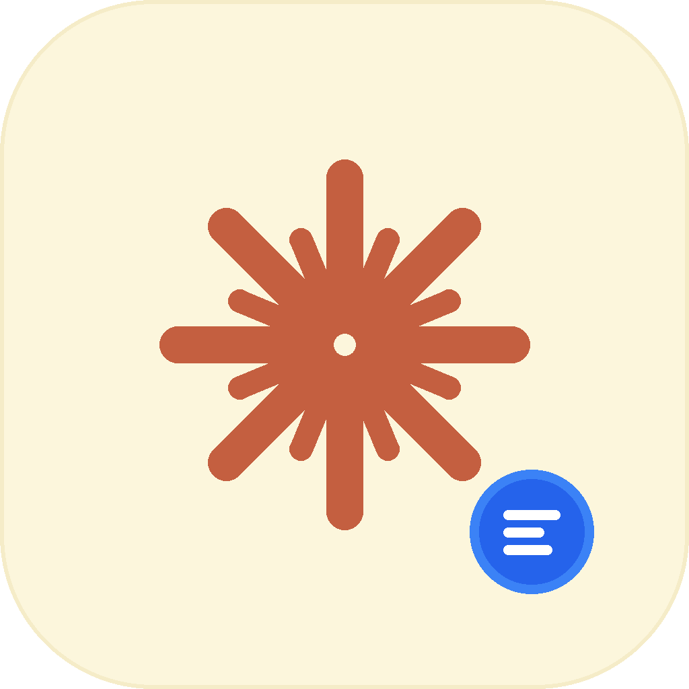

# CC Desk

**Desktop companion for [Claude Code](https://docs.anthropic.com/en/docs/claude-code)** — browse sessions, manage workspaces, switch providers, and launch / resume chats in Terminal.

Claude Code 桌面伴侣：历史会话、Workspace、供应商切换，一键在 macOS Terminal 启动或 Resume。

[](https://github.com/kou-123/cc-desk)
[](https://www.electronjs.org/)
[](https://react.dev/)
[](https://www.typescriptlang.org/)

<p align="center">
  
</p>

---

## Why CC Desk?

Claude Code 本身很强，但会话散落在 `~/.claude/projects`，多项目、多供应商时切换成本高。CC Desk 把这些收成一个桌面面板：

| 痛点 | CC Desk |
|------|---------|
| 找不到旧会话 | 按项目 / Recents 浏览，Markdown 预览 transcript |
| 多目录协作麻烦 | Workspace + `--add-dir`，一键开聊 |
| 供应商 / 模型来回改 | 本地 Provider 管理，写入 `~/.claude/settings.json` |
| 只想继续上次 | Resume 拉起 Terminal，并自动同步预览 |

适合日常用 Claude Code 的 macOS 用户，尤其是多仓库、多 API 线路的场景。

---

## Features

- **Sessions** — 自动发现本机 Claude Code 会话，按项目树或 Recents 查看；支持删除、打开所在文件夹
- **Transcript preview** — Markdown 渲染、折叠块、图片缩略图；Resume 后实时同步 Terminal 里的更新
- **Workspaces** — 多文件夹项目（Primary + Add dirs），右键编辑，从已知项目一键并入
- **Launch / Resume** — 在 Terminal.app 启动 `claude` 或 resume 指定会话
- **Providers & models** — 本地 `providers.json` 优先；可从本机 CC Switch（`~/.cc-switch`）一次性合并导入；别名映射（Sonnet / Opus / Haiku 等）与 1M 上下文
- **Settings** — 全页设置：Model、Claude Code 版本检测与一键更新指引
- **UI** — 深色 / 浅色主题，侧栏搜索，截断路径 hover 提示

---

## Requirements

- macOS（当前打包目标为 Apple Silicon / `mac-arm64`）
- [Node.js](https://nodejs.org/) 18+
- 已安装 [Claude Code](https://docs.anthropic.com/en/docs/claude-code) CLI（`claude` 在 PATH 中）

---

## Quick start

```bash
git clone git@github.com:kou-123/cc-desk.git
cd cc-desk
npm install --ignore-scripts
bash scripts/install-electron.sh   # 若 Electron 二进制缺失
```

### 开发

```bash
# 浏览器 + 本地 API
npm run dev
# → http://127.0.0.1:5173

# 桌面窗口（Electron）
npm run electron:dev
```

### 打包

```bash
npm run electron:build
# → release/mac-arm64/CC Desk.app

npm run electron:dist   # 可选：生成 DMG
```

首次打开若被 macOS 拦截：右键 → 打开，或拖到「应用程序」。

---

## Usage

1. 打开 **CC Desk**，左侧浏览 **Projects** 或底部切到 **Recents**
2. 点选会话查看 transcript；需要继续时点 **Resume**（Terminal 启动，面板自动同步）
3. **New chat** 选择项目 / Workspace 后开新会话
4. 右键项目 → **Edit project** 管理 Source folders
5. 齿轮进入 **Settings** → 管理 Provider、模型别名，或查看 Claude Code 版本

---

## Tech stack

| Layer | Stack |
|-------|--------|
| UI | React 19 · TypeScript · Vite |
| Desktop | Electron |
| Local API | Node.js · Express |
| Data | `~/.claude/projects`（jsonl）、本地 workspace / providers 配置 |

---

## Privacy

- 会话与配置数据都在本机；应用不会上传你的 transcript 或 API Key
- 仓库已忽略 `data/workspaces.json`、`data/providers.json` 等个人路径与密钥文件

---

## Contributing

Issue / PR 都欢迎。改动前建议先跑通：

```bash
npm run build
npm run electron:dev
```

---

## License

MIT — see [LICENSE](./LICENSE).

---

<p align="center">
  <b>CC Desk</b> · Claude Code, but with a desk.
</p>
