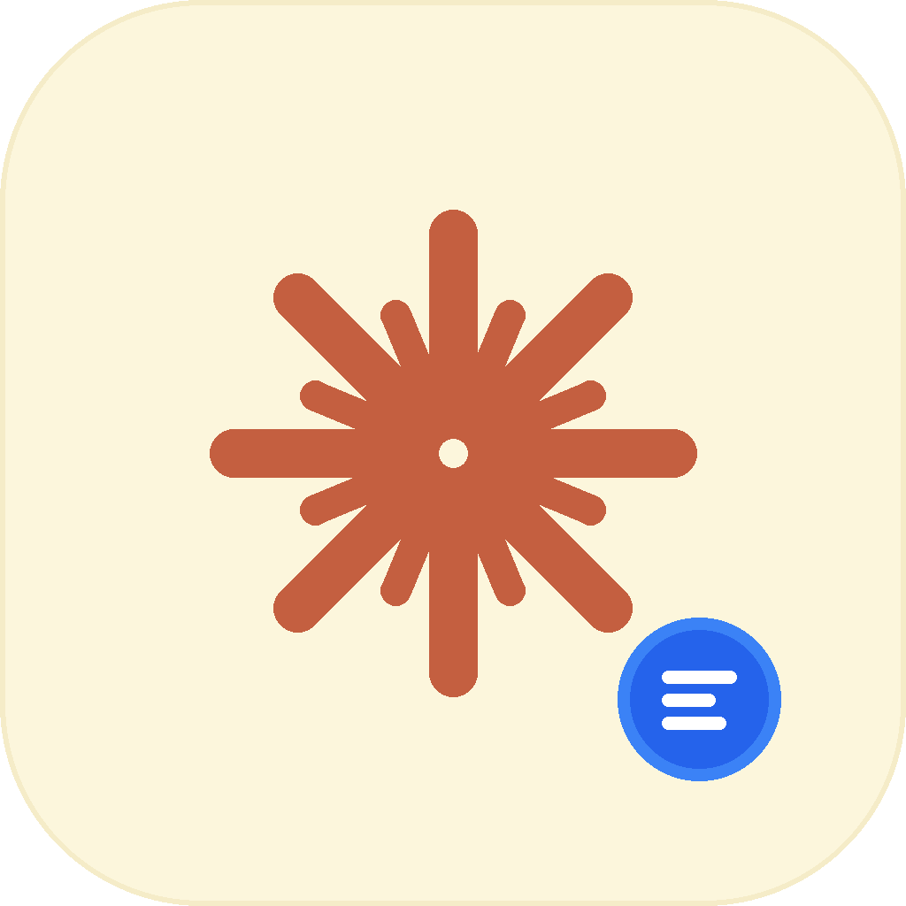

# CC Desk

**Desktop companion for [Claude Code](https://docs.anthropic.com/en/docs/claude-code)** — browse sessions, manage workspaces, switch providers, and chat with the local CLI directly in the panel.

选择项目或历史会话即可在面板中提问，实时查看本地 Claude Code 的回复。Enter 发送，Shift+Enter 换行。

[](https://github.com/kou-123/cc-desk)
[](https://github.com/kou-123/cc-desk/releases/latest)
[](https://www.electronjs.org/)
[](https://react.dev/)
[](https://www.typescriptlang.org/)

<p align="center">
  
</p>

---

## Download（推荐）

普通用户**不用拉代码**，直接下载安装包：

➡️ **[Latest Release](https://github.com/kou-123/cc-desk/releases/latest)**

| 文件 | 说明 |
|------|------|
| `CC Desk-*-arm64.dmg` | 拖进「应用程序」安装（Apple Silicon） |
| `CC-Desk-*-mac-arm64.zip` | 解压即得 `CC Desk.app` |

**打开提示：** 当前未做 Apple 公证签名。若提示「无法打开 / 已损坏」：

1. 右键应用 → **打开** → 仍选择打开；或  
2. 终端执行：`xattr -cr "/Applications/CC Desk.app"`

还需本机已安装 **Claude Code** CLI（`claude` 命令可用）。

---

## Why CC Desk?

Claude Code 本身很强，但会话散落在 `~/.claude/projects`，多项目、多供应商时切换成本高。CC Desk 把这些收成一个桌面面板：

| 痛点 | CC Desk |
|------|---------|
| 找不到旧会话 | 按项目 / Recents 浏览，Markdown 预览 transcript |
| 多目录协作麻烦 | Workspace + `--add-dir`，一键开聊 |
| 供应商 / 模型来回改 | 本地 Provider 管理，写入 `~/.claude/settings.json` |
| 只想继续上次 | 面板里直接续聊，或一键打开 macOS Terminal（带模型 / 信任目录） |

适合日常用 Claude Code 的 macOS 用户，尤其是多仓库、多 API 线路的场景。

---

## Features

- **Sessions** — 自动发现本机 Claude Code 会话；侧栏悬停可新建（`+`）/ 删除（`×`）；空会话直接删，有内容会确认
- **Transcript preview** — Markdown 渲染、思考折叠；气泡里的图片可点击放大 / 右键或按钮复制；打开 Terminal 后可「终端预览同步」
- **Workspaces** — 多文件夹项目（Primary + Add dirs），右键编辑；悬停 workspace 行的 `+` 可在该项目新建会话
- **Chat** — 面板内提问 / 停止 / 续聊；粘贴或拖入图片与文件（附件缩略图可放大、复制）；权限模式（Ask / Accept edits / Auto / Plan）与模型选择
- **Terminal launch** — 「打开 Claude Code 命令行」默认拉起 **macOS Terminal.app**，带上当前模型与权限模式，并自动信任工作目录
- **Providers & models** — 本地 `providers.json`；可从本机 CC Switch（`~/.cc-switch`）合并导入；别名映射与 1M 上下文
- **Settings** — Model、Skills（`~/.claude/skills`）、MCP（`~/.claude.json`，可展开看工具 / 编辑用户级条目）、Appearance 字号、About / CLI 更新
- **UI** — 深色 / 浅色主题，侧栏搜索，截断路径 hover 提示

---

## Requirements

- macOS（当前发布包为 **Apple Silicon / arm64**）
- 已安装 [Claude Code](https://docs.anthropic.com/en/docs/claude-code) CLI（`claude` 在 PATH 中）
- 从源码开发时另需 [Node.js](https://nodejs.org/) 18+

---

## Build from source（开发者）

只想用软件 → 看上面的 [Download](#download推荐)。下面给改代码 / 自己打包用：

```bash
git clone git@github.com:kou-123/cc-desk.git
cd cc-desk
npm install --ignore-scripts
bash scripts/install-electron.sh   # 若 Electron 二进制缺失
```

```bash
# 浏览器 + 本地 API → http://127.0.0.1:5173
npm run dev

# 桌面窗口
npm run electron:dev

# 打出 .app
npm run electron:build
# → release/mac-arm64/CC Desk.app

# 打出 DMG（可上传到 GitHub Releases）
npm run electron:dist
```

---

## Usage

1. 打开 **CC Desk**，左侧浏览 **Projects** 或底部切到 **Recents**
2. 点选会话：可在底部输入框继续提问；需要完整 TUI 时点 **打开 Claude Code 命令行**
3. 拖入 / 粘贴图片后可点缩略图放大或复制；发送后聊天气泡里同样支持
4. **New chat**，或悬停 workspace 行的 **`+`**，在对应项目下新建会话
5. 悬停会话行的 **`×`** 删除会话（空会话直接删）
6. 右键项目 → **Edit project** 管理 Source folders
7. 齿轮 → **Settings**：Provider / 模型、Skills、MCP、字号、Claude Code 版本

---

## Tech stack

| Layer | Stack |
|-------|--------|
| UI | React 19 · TypeScript · Vite |
| Desktop | Electron |
| Local API | Node.js · Express |
| Data | `~/.claude/projects`（jsonl）、本地 workspace / providers 配置 |

---

## Privacy

- 会话与配置数据都在本机；应用不会上传你的 transcript 或 API Key
- 仓库已忽略 `data/workspaces.json`、`data/providers.json` 等个人路径与密钥文件

---

## Contributing

Issue / PR 都欢迎。改动前建议先跑通：

```bash
npm run build
npm run electron:dev
```

---

## License

MIT — see [LICENSE](./LICENSE).

---

<p align="center">
  <b>CC Desk</b> · Claude Code, but with a desk.
</p>
